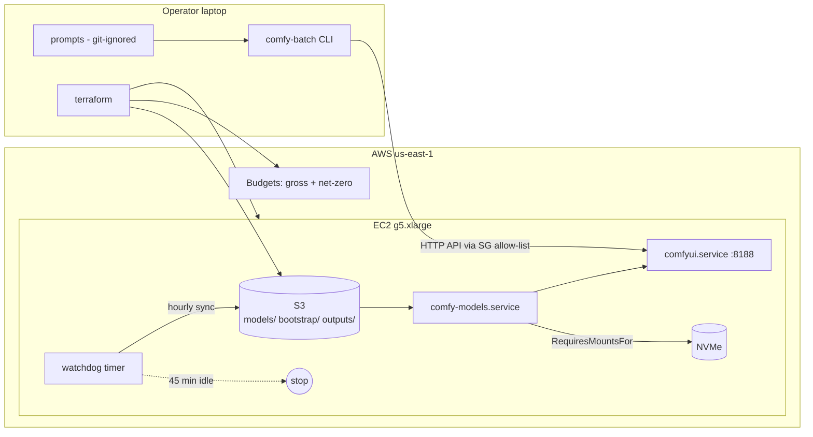

# comfyui-on-aws

**A GPU inference node on AWS, built like production infrastructure: Terraform, systemd,
least-privilege IAM, a cost watchdog, budgets that actually fire, and CI on every change.**

The workload is [ComfyUI](https://github.com/comfyanonymous/ComfyUI) running a quantised
Qwen-Image-Edit model on an NVIDIA A10G. The interesting part is not the model - it is
everything around it: getting a GPU on a credit-funded account, booting it repeatably,
keeping the bill at zero, and tearing it all down cleanly.

[](https://github.com/Dude775/comfyui-on-aws/actions/workflows/ci.yml)
[](https://github.com/Dude775/comfyui-on-aws/actions/workflows/security.yml)


---

## At a glance

| | |
|---|---|
| **Compute** | EC2 `g5.xlarge` - NVIDIA A10G 24 GB, AWS Deep Learning AMI (Ubuntu 22.04) |
| **Storage** | S3 as source of truth for ~21 GB of weights; instance-store NVMe as the hot copy |
| **Boot** | `user-data` -> S3-shipped assets -> three systemd units with explicit ordering |
| **Access** | SG allow-list per operator `/32`, IMDSv2 only, SSM Session Manager, no public auth surface |
| **Cost control** | GPU-idle watchdog (5 min tick, 45 min idle -> stop), gross + net-zero budgets, teardown script |
| **CI** | terraform fmt/validate, tflint, shellcheck, 18 watchdog logic tests, pytest, ruff, gitleaks, checkov |
| **Result** | ~31 s per 4-step edit at 1024 px; full month of experiments covered by credits, $0 out of pocket |

## Architecture



Full write-up: [docs/architecture.md](docs/architecture.md)

## Repository layout

```
infra/terraform/     what exists in AWS        - VPC SG, IAM, S3, EC2, budgets
bootstrap/           how a node becomes ready  - user-data, model sync, systemd units
ops/
  watchdog/          what keeps it cheap       - GPU-idle auto-stop + output sync, with tests
  cost/              what it costs             - preflight checks, gross vs net report
  teardown/          how it ends               - inventory-first, confirm-to-delete
pipeline/            how work is submitted     - stdlib ComfyUI API client + batch CLI
tests/               pipeline unit tests       - graph injection, recipe guardrails
docs/                why it is built this way  - architecture, ADRs, lessons, runbook
.github/workflows/   ci, security, manual OIDC plan
```

Each layer has one owner-role and one interface to the next. The pipeline never calls
AWS APIs; the infrastructure never sees prompts or images
([ADR 0003](docs/adr/0003-privacy-boundary.md)).

## Quick start

```bash
cp infra/terraform/terraform.tfvars.example infra/terraform/terraform.tfvars   # fill in
make preflight     # not root, G/VT quota >= 4 vCPU, current IP allowed
make plan apply
terraform -chdir=infra/terraform output comfy_url
```

Upload weights once to `s3://<bucket>/models/{unet,text_encoders,loras,vae,upscale_models}/`.
Every boot re-syncs them to NVMe in ~3 minutes.

```bash
cd pipeline
python -m comfy_pipeline.cli --server http://<ip>:8188 \
  --workflow workflows/my-graph.json --prompts prompts.txt --quiet
```

End of session: `make stop`. End of project: `make teardown ARGS=--apply`.
Day-2 operations: [docs/runbook.md](docs/runbook.md)

## Cost guardrails

AWS credits are consumed automatically and there is **no native "stop when the credit
runs out"** - once spent or expired, usage bills the card.

- **Net vs gross.** A budget with `IncludeCredit=true` reads $0 while credits cover usage,
  so an action on it fires only after real money is charged. Guards belong on a **gross**
  budget; a $1 **net** budget is the "credit ran out" tripwire.
- **Alerts are not brakes.** Billing data lags up to ~24 h. The on-instance watchdog is
  the only control that acts in minutes.
- **Stopped is not free.** A stopped node still costs ~$6.5/month in EBS + S3. The project
  ends with a full teardown, not a parked instance.

Details and real numbers: [docs/cost-guardrails.md](docs/cost-guardrails.md)

## The model recipe (pinned by CI)

| Setting | Value | Why |
|---|---|---|
| Model | Qwen-Image-Edit-2511, GGUF Q4_K_M | fits 24 GB with the 7B text encoder |
| Steps / CFG | 4 / 1.0 | Lightning distillation LoRA |
| Sampler / scheduler | `euler` / `simple` | `dpm_2/karras` produced pure noise |
| `ModelSamplingAuraFlow` | shift 3.0, `sampling=flow` | `img_to_img_velocity` returned copies of the input |
| Latent source | `LoadImage -> VAEEncode` | `EmptyLatentImage` ignored the source photo |

`tests/test_graph.py` fails the build if the committed workflow drifts from this recipe.

## What went wrong (and what it taught me)

Eleven real incidents, each with symptom, cause, fix and lesson:
[docs/lessons-learned.md](docs/lessons-learned.md). Highlights:

- **Free Plan silently blocks GPUs** even after quota approval - the account plan is a
  prerequisite, not a detail.
- **A mount race filled the root disk to 100%** - "the directory exists" is not "the disk
  is mounted". Fixed with `RequiresMountsFor` and a `mountpoint -q` gate.
- **Budgets that could never fire** - `IncludeCredit=true` measures net spend, which is
  zero right up until the card pays.

## Decisions

| ADR | Decision |
|---|---|
| [0001](docs/adr/0001-on-demand-over-spot.md) | On-demand by default, spot as a switch - capacity beat price |
| [0002](docs/adr/0002-models-on-instance-store.md) | Weights on free NVMe, S3 as source of truth |
| [0003](docs/adr/0003-privacy-boundary.md) | Prompts and images never cross the infra boundary |
| [0004](docs/adr/0004-watchdog-over-budget-actions.md) | On-instance watchdog as the primary brake |

## Local checks

```bash
make lint test validate
```

Same jobs as CI. `pre-commit install` runs fmt, shellcheck, ruff and gitleaks on commit.

## Status

Built, run and **fully decommissioned** in October 2026. Every resource was destroyed with
the teardown order in the runbook; the account bills $0. The code is kept as a
reproducible reference.

---

**David Rubin** - DevOps / Cloud engineer, AWS Certified Solutions Architect - Associate.
[LinkedIn](https://linkedin.com/in/david-rubin-a02029338) |
[Portfolio](https://system-portfolio.vercel.app) |
[GitHub](https://github.com/Dude775)
