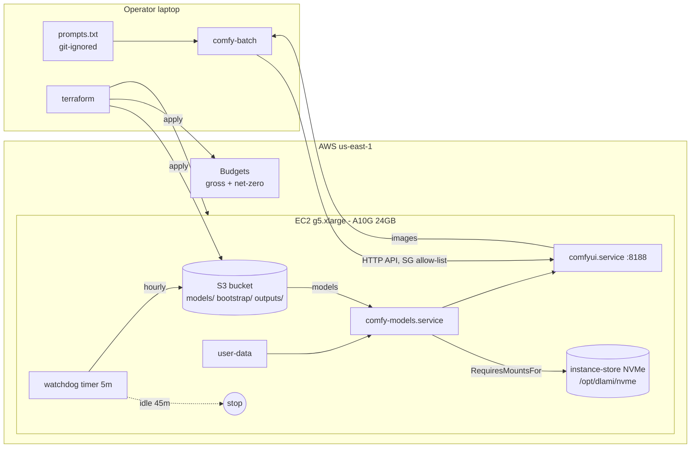

# Architecture

## Layers and ownership

The repo is split by **who acts and when**. Each layer has one job and talks to the
next one only through a narrow, explicit interface.

| Layer | Path | Runs where | Runs when | Interface to next layer |
|---|---|---|---|---|
| Infrastructure | `infra/terraform` | operator laptop / CI | `make plan apply` | S3 objects under `bootstrap/`, instance user-data |
| Bootstrap | `bootstrap/` | GPU node, as root | first boot + every boot | systemd units `comfy-models`, `comfyui` |
| Operations | `ops/` | GPU node + laptop | every 5 min / on demand | systemd timer, AWS CLI |
| Pipeline | `pipeline/` | operator laptop | ad hoc | ComfyUI HTTP API on `:8188` |
| CI | `.github/workflows` | GitHub Actions | push / PR / weekly | none - it only reads the repo |

The pipeline layer never touches AWS APIs, and the infrastructure layer never touches
prompts or images. That boundary is what keeps private content off the cloud control
plane and out of CI logs.

## Runtime view

## Storage tiers

| Data | Lives on | Survives stop | Survives terminate | Why |
|---|---|---|---|---|
| Model weights (~21 GB) | S3 `models/` -> NVMe | NVMe: no, S3: yes | S3: yes | NVMe is free and fast; re-sync is ~3 min |
| ComfyUI code, venv | root EBS (75 GB gp3) | yes | no | avoids a 10 min reinstall on every start |
| Generated images | EBS -> S3 `outputs/` hourly | yes | S3 copy only | lifecycle rule expires them after 30 days |
| Prompts | operator laptop only | n/a | n/a | private content never leaves the laptop |

## Request path

1. `comfy-batch` calls `GET /system_stats` - fails fast if the node is down or the SG
   does not allow the current IP.
2. Each prompt is injected into a committed **API-format** graph (`{prompt}` placeholder),
   seeds are rolled, and the graph is `POST /prompt`-ed.
3. The client polls `/history/<id>` and downloads results through `/view`.
4. The watchdog sees a non-empty `/queue` and keeps the node alive while work is pending.
